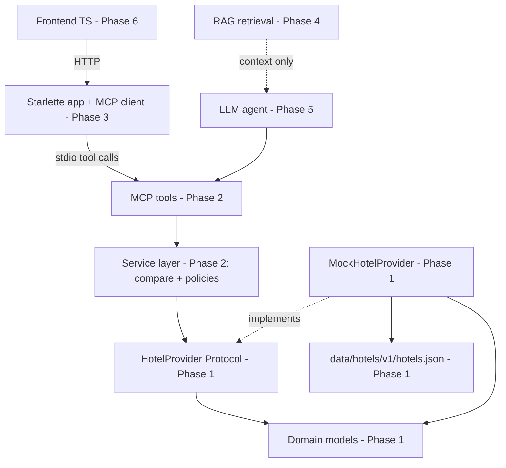

# Architecture

## Implementation status

Read this first. This document describes the designed architecture and the component responsibilities StaySmart AI will have. Only the foundation is implemented so far. Nothing below the status line should be read as an available feature.

| Component | Phase | Status |
| --- | --- | --- |
| Packaging, uv environment, configuration surface, documentation scaffold | 0 | Implemented |
| Domain models, config loader, mock dataset, inventory, provider | 1 | Not yet implemented |
| Service layer, MCP server and five tools | 2 | Not yet implemented |
| Starlette app and MCP client | 3 | Not yet implemented |
| RAG ingestion, indexing and retrieval | 4 | Not yet implemented |
| LLM agent orchestration | 5 | Not yet implemented |
| TypeScript frontend | 6 | Not yet implemented |

## Designed layering

Dependencies point inward. Domain models depend on nothing. The provider Protocol depends only on domain models. The mock provider is the only component that knows data is mock. A thin service layer will derive `compare_hotels` and `get_hotel_policies` by composing provider operations, so neither is baked into the provider. MCP tools will own their input schemas via type hints and depend on the Protocol plus the service, never on the concrete provider. The Starlette app will host an MCP client and serve the frontend. RAG is a separate retrieval channel for descriptive context and will never supply prices or availability. The LLM agent will sit above the tools through a configurable OpenAI-compatible endpoint. Configuration is the composition root, and `HOTEL_PROVIDER` selects the implementation.

## Component responsibilities (design)

| Component | Responsibility |
| --- | --- |
| `src/staysmart/domain/` | Pure pydantic v2 contracts and the error taxonomy. No I/O. |
| `src/staysmart/config.py` | Typed settings from environment variables, provider factory inputs, logging setup. |
| `src/staysmart/providers/base.py` | `HotelProvider` Protocol with async `search`, `get_hotel_details`, `check_availability`. |
| `src/staysmart/providers/mock/` | Versioned JSON dataset loader, deterministic date-aware inventory, `MockHotelProvider`. |
| `src/staysmart/services/` | Comparison and policy derivation composed from provider results. |
| `src/staysmart/mcp_server/` | MCP tools with explicit input and output schemas, validation and error mapping. |
| `src/staysmart/app/` | Starlette endpoints, request validation, exception handling, health status. |
| `src/staysmart/rag/` | Document ingestion, chunking, FastEmbed embeddings, local vector index, retrieval, source attribution. |
| `src/staysmart/agent/` | Natural-language interpretation, tool selection, sequential tool calls, grounded response generation, safeguards. |
| `frontend/` | Presentation and user interaction only. |

## Invariants

- Every hotel result carries `data_source="mock"` and `is_live=False`, so mock data is never confused with live inventory.
- A validated `HotelSearchQuery` exists before any hotel search tool call.
- No hotel fact, price or availability value is invented. Missing data is reported as missing.
- Structured hotel search and RAG retrieval stay separate. Live prices and availability never come from RAG documents.
- MCP communication over stdio stays separate from the frontend HTTP interface.
- The provider interface is replaceable. A real connectivity provider can implement the same Protocol later.
- No reservations, payments or booking transactions.

## Data flow (design)

A user message will be interpreted into a validated structured query. The agent will choose MCP tools, call them over stdio, and receive structured results. For comparison and recommendations, the service layer will combine provider facts with retrieved policy context. The Starlette layer will return structured JSON to the frontend, which renders result cards, comparison views, details, policy sources, and loading or error states.
