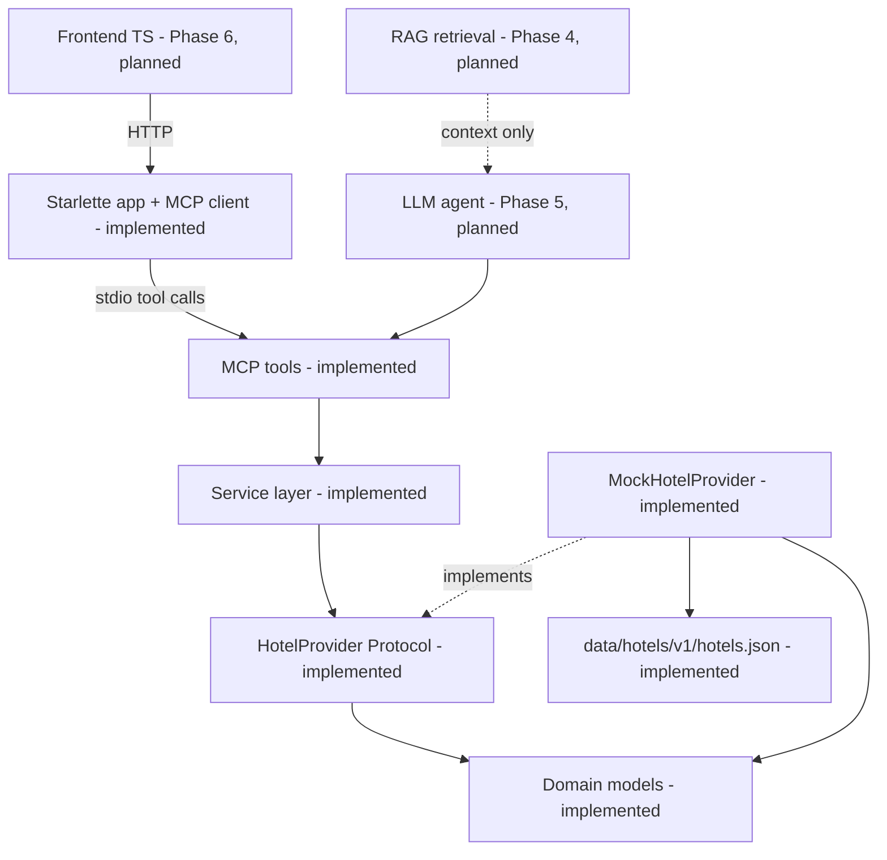

# Architecture

## Implementation status

Read this first. Phases 0 through 3 are implemented. Everything marked "not yet implemented" below is a design note, not an available feature.

| Component | Phase | Status |
| --- | --- | --- |
| Packaging, uv environment, configuration surface, documentation scaffold | 0 | Implemented |
| Domain models, config loader, mock dataset, inventory, provider | 1 | Implemented |
| Service layer, MCP server and five tools | 2 | Implemented |
| Starlette app and MCP client | 3 | Implemented |
| RAG ingestion, indexing and retrieval | 4 | Not yet implemented |
| LLM agent orchestration | 5 | Not yet implemented |
| TypeScript frontend | 6 | Not yet implemented |

## Layering

Dependencies point inward. Domain models depend on nothing. The provider Protocol depends only on domain models. `MockHotelProvider` is the only component that knows the data is mock. The service layer (`compare_hotels`, `get_hotel_policies`) composes provider operations through the Protocol. MCP tools own their input schemas via type hints and depend on the Protocol plus the service, never on the concrete provider. The Starlette app hosts an MCP client that speaks stdio to the server subprocess and serves the frontend over HTTP; its request models mirror the tool inputs and its error handlers classify tool failures. RAG is a separate retrieval channel for descriptive context and will never supply prices or availability. The LLM agent will sit above the tools through a configurable OpenAI-compatible endpoint. Configuration is the composition root, and `HOTEL_PROVIDER` selects the implementation.



## Implemented Phase 1 components

| Component | Responsibility |
| --- | --- |
| `src/staysmart/config.py` | Frozen `Settings` dataclass with `from_env()` and `configure_logging()`. Reads `HOTEL_PROVIDER`, `STAYSMART_DATASET_PATH`, `STAYSMART_LOG_LEVEL`, `STAYSMART_CURRENCY`, `STAYSMART_WINDOW_DAYS`. Rejects unsupported providers and invalid window values. |
| `src/staysmart/domain/models.py` | Pydantic v2 contracts with `extra="forbid"`. Includes `HotelSearchQuery` and `QuoteRequest` stay validators, `StayQuote`, `HotelSearchResult`, `HotelDetails`, `AvailabilityResult`, and comparison types with no Phase 1 logic. |
| `src/staysmart/domain/errors.py` | `StaySmartError` with a `to_dict()` helper for later HTTP and MCP mapping, plus `InvalidDateError`, `UnknownDestinationError`, `UnknownHotelError`, `UnknownRoomTypeError`, `CurrencyMismatchError`, `ProviderError`. |
| `src/staysmart/providers/base.py` | `HotelProvider` Protocol with async `search`, `get_hotel_details`, `check_availability`. |
| `src/staysmart/providers/mock/dataset.py` | Loads and validates the versioned JSON dataset, checks references and date strings, builds an `InventoryContext`, wraps I/O and validation failures in `ProviderError`. |
| `src/staysmart/providers/mock/inventory.py` | Pure deterministic inventory. SHA-256 seeded nightly rate and capacity, weekend and peak-month multipliers, bounded jitter, sold-out overrides, destination blackout dates, partial availability handling, and date-window validation. |
| `src/staysmart/providers/mock/provider.py` | `MockHotelProvider` plus `get_provider()`. Destination resolution, budget/rating/amenity filtering, one quote per hotel, deterministic sorting, unmet preference reporting, details and availability composition, and structured logging. |
| `data/hotels/v1/hotels.json` | 3 destinations, 10 hotels, 13 room types, varied ratings (6.8 to 9.4), base rates (55 to 340 USD), four cancellation policy types, sold-out overrides and a blackout date. Anchor date `2026-11-01`, 365-day window. |
| `scripts/demo_provider.py` | Runs four operations over a fixed scenario and writes a deterministic JSON artifact to `artifacts/provider_demo.json`. |
| `tests/phase1/` | Behavioral contract, 42 pytest tests, and a spec-authored golden artifact. |
| `src/staysmart/domain/models.py` (Phase 2 additions) | `HotelComparison` extended with `unresolved_hotel_ids`, stay context fields and mock markers; new `HotelPolicyInfo` with pet policy provenance and explicit `information_gaps`. |
| `src/staysmart/services/comparison.py` | `compare_hotels` over the provider Protocol: eager stay-length validation, id dedupe, unknown ids to `unresolved_hotel_ids`, nightly price and total stay price minima over room quotes, preference verification. |
| `src/staysmart/services/policies.py` | `get_hotel_policies` over the provider Protocol: cancellation facts, pet policy derived from amenities with a source marker, honest `information_gaps`. |
| `src/staysmart/mcp_server/server.py` | `build_mcp_server` constructing the SDK 2.x `MCPServer` (`staysmart-hotels`, `0.1.0`) with mock-disclosing instructions. |
| `src/staysmart/mcp_server/tools.py` | Five type-hinted tools returning pydantic models; `StaySmartError` to `ToolError` mapping; currency pinned from settings; empty-comparison guard. |
| `src/staysmart/mcp_server/__main__.py` | `python -m staysmart.mcp_server` stdio entrypoint. |
| `scripts/demo_mcp.py` | In-process MCP client runs the contract scenarios and writes `artifacts/mcp_demo.json`. |
| `tests/phase2/` | Behavioral contract, 47 pytest tests (service, in-process tool calls, real stdio subprocess, snapshot), spec-authored golden artifact. |
| `src/staysmart/config.py` (Phase 3 additions) | `Settings` gains `http_host`, `http_port` and `cors_origins` from `STAYSMART_HTTP_HOST`, `STAYSMART_HTTP_PORT`, `STAYSMART_CORS_ORIGINS`, validated like the existing settings. |
| `src/staysmart/app/mcp_client.py` | Connector seam: `McpSession` and `McpConnector` protocols, `StdioMcpConnector` launching `python -m staysmart.mcp_server` as a stdio subprocess, `InProcessMcpConnector` for tests and demos, and a session adapter raising `ToolFailureError` on `is_error` results. |
| `src/staysmart/app/errors.py` | `ApiError` with the `{"error": {...}}` envelope, tool-failure classifier mapping provider message fragments to 404/400/502, and handlers for validation errors, malformed JSON, unknown routes and unhandled exceptions. |
| `src/staysmart/app/routes.py` | Request models mirroring the tool inputs (`extra="forbid"`, `ge=1` on guests and rooms) and the seven endpoints. Each data endpoint performs exactly one MCP tool call and returns the payload verbatim; `/api/chat` validates the request and returns 501 `agent_not_available`. |
| `src/staysmart/app/main.py` | `create_app(settings, connector=None)` wiring the lifespan (one long-lived MCP session), CORS middleware, routes and error handlers. |
| `src/staysmart/app/__main__.py` | `python -m staysmart.app` uvicorn entrypoint. |
| `scripts/demo_api.py` | Launches a real uvicorn server on an ephemeral port with the stdio connector, calls every endpoint and writes `artifacts/api_demo.json`. |
| `tests/phase3/` | Behavioral contract, 33 pytest tests (health, endpoints, error mapping, CORS, real stdio transport, snapshot), spec-authored golden artifact. |

### Search flow as implemented

A `HotelSearchQuery` is validated on construction. `MockHotelProvider.search()` re-validates it at the boundary, checks the currency and date window, resolves the destination against destination id, city, country and region, filters hotels by rating and required amenities, builds quotes for room types that can hold the party, drops quotes above the nightly budget, picks one quote per hotel, sorts results with fully available stays first, and reports unmet filters or unverified free-text preferences. All results carry `data_source="mock"` and `is_live=False`.

### Inventory as implemented

For each night in `[check_in, check_out)`:

```
seed = int.from_bytes(sha256(f"{hotel_id}:{room_type_id}:{iso_date}").digest()[:8], "big")
rate = round(base_nightly_rate * weekend * peak * jitter, 2)
capacity = seed % (total_rooms + 1)
sold_out = capacity < rooms OR iso_date in sold_out_overrides OR iso_date in blackout_dates
```

`weekend` is 1.15 on Friday and Saturday, `peak` is 1.10 in July, August and December, and `jitter` is a deterministic value from minus 15 to plus 15 percent. Available nights contribute rates, sold-out nights contribute ISO dates. `total_price` is set only when every night is available. There is no `datetime.now()` in provider code.

## Component responsibilities (planned)

| Component | Responsibility |
| --- | --- |
| `src/staysmart/rag/` | Document ingestion, chunking, FastEmbed embeddings, local vector index, retrieval, source attribution. |
| `src/staysmart/agent/` | Natural-language interpretation, tool selection, sequential tool calls, grounded response generation, safeguards. |
| `frontend/` | Presentation and user interaction only. |

## Invariants

- Every hotel result carries `data_source="mock"` and `is_live=False`, so mock data is never confused with live inventory.
- A validated `HotelSearchQuery` exists before any hotel search operation.
- No hotel fact, price or availability value is invented. Missing availability is reported as missing.
- Structured hotel search and RAG retrieval stay separate. Live prices and availability never come from RAG documents.
- MCP communication over stdio stays separate from the frontend HTTP interface: the browser only ever talks to the Starlette layer, and each HTTP data operation maps to one MCP tool call.
- The HTTP layer holds no hotel business logic: request models mirror tool inputs, and success payloads pass through unchanged.
- The provider interface is replaceable. A real connectivity provider can implement the same Protocol later.
- No reservations, payments or booking transactions.

## Data flow (as of Phase 3)

HTTP requests arrive at the Starlette layer, where request models validate shape (`extra="forbid"`, positive guests and rooms). Each data endpoint forwards its arguments through one MCP tool call over the stdio session and returns the tool payload verbatim. Tool failures carry the provider message, which the HTTP classifier maps to 404, 400 or 502; MCP session failures become 503. In Phase 5 a user message will additionally be interpreted into validated structured queries by the LLM agent, which will choose MCP tools, call them over stdio, and combine provider facts with retrieved policy context before generating a grounded response. The frontend (Phase 6) will render result cards, comparison views, details, policy sources, and loading or error states from this JSON.
